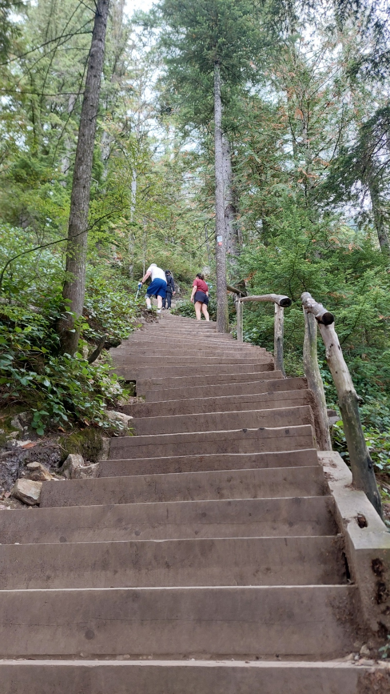
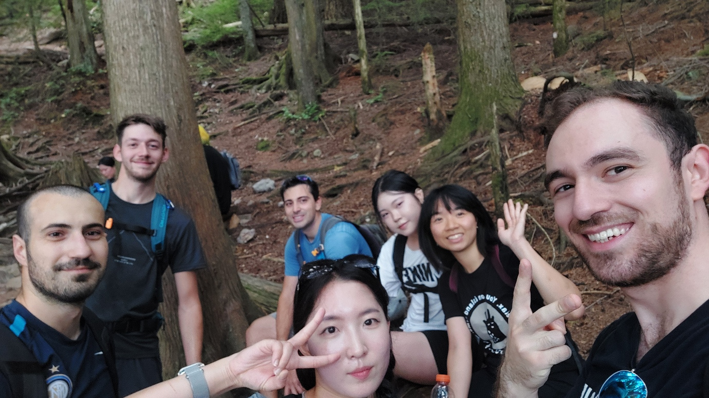
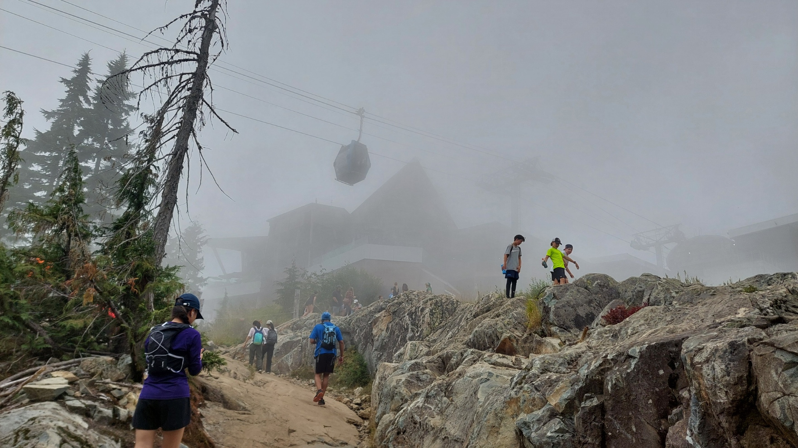
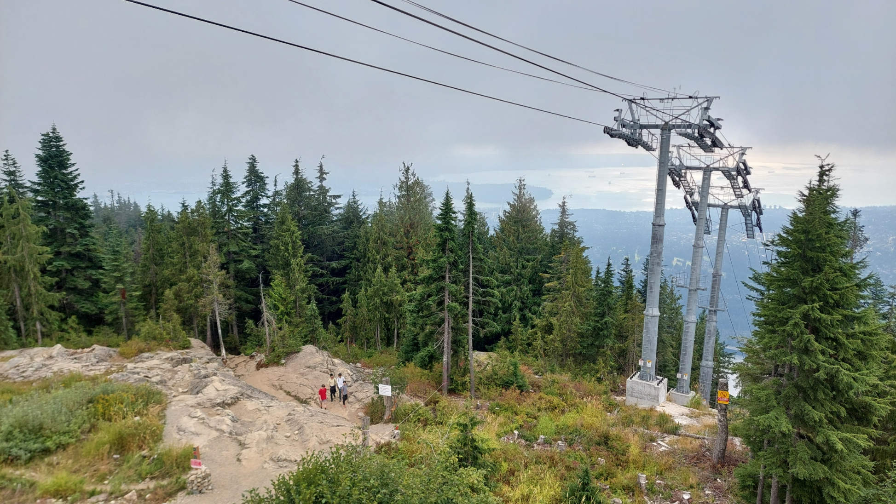
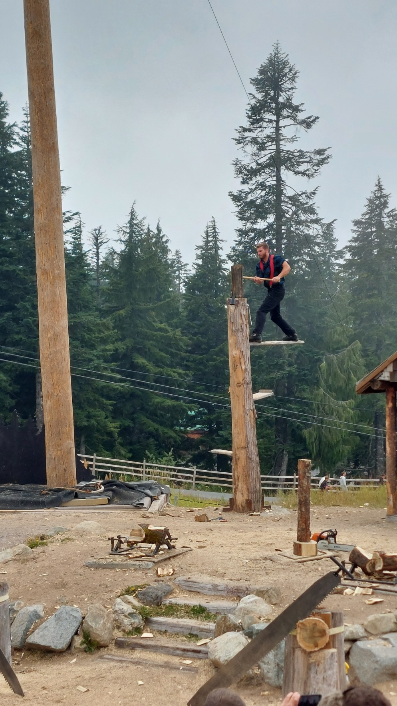
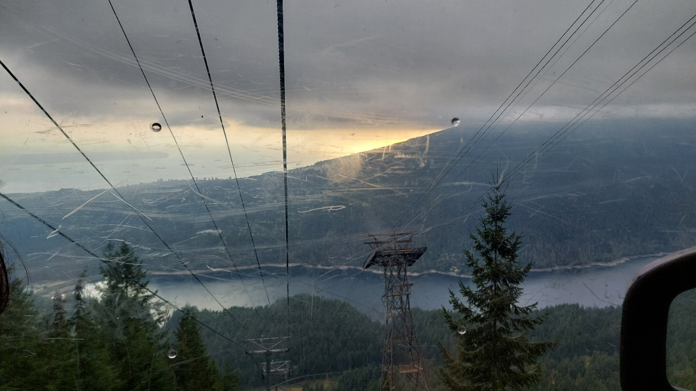
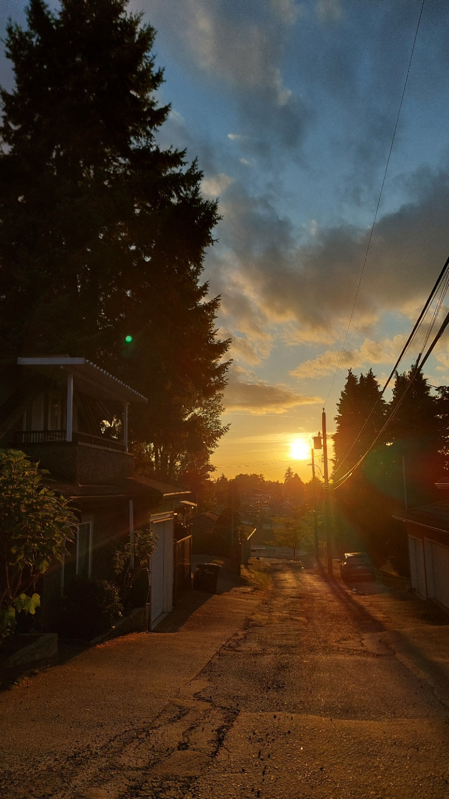

Some plans take months of preparation. Others come together the evening before. My roommates wanted to hike the Grouse Grind and asked whether I would like to join them. Around 800 metres of elevation gain, they said. That sounded incredibly exhausting, like a proper challenge and like something I would very much like to be part of.

Luckily, I had packed my hiking boots. They had already made quite an appearance on my journey to Canada. Now they could finally do what they were actually meant for.

## Familiar faces, a new mountain

The next day, we set off by car towards North Vancouver around midday. There, we met the rest of our little hiking group. The faces were not entirely unfamiliar. A few days earlier, we had shared a potluck. Everyone brings a dish, and all those contributions become a shared buffet. A pretty lovely way to get to know people.

This time, though, there was no table full of food waiting for us. There was a mountain. Grouse Mountain, to be precise. The [Grouse Grind](https://www.grousemountain.com/grousegrind.html) is the steep hiking trail up it. Over about 2.5 kilometres, you climb around 800 metres and roughly 2,830 steps. Plenty of forest, plenty of stairs and one fairly clear direction: up.

It had been about a year since my last hike. An excellent opportunity, then, to jump straight back in with something a little more ambitious.

## Step by step

With a water bottle, my hiking boots and hiking clothes, off we went. I had a healthy respect for the climb, but I was just as excited about it. And that excitement stayed with me along the way, even as my legs began to notice all those promised metres of climbing.

At first, we chatted quite casually about this and that as we made our way higher between the tall trees. About a quarter of the way up, the conversations became a little shorter, and catching our breath took up more of our attention. Breathe in, breathe out, next step.

_In case there was still any doubt about which way we were going. My own photo._

We took breaks, caught our breath and tackled the next stretch. Not particularly quickly, but bit by bit. Between the roots, rocks and all those steps, there was a beautiful forest to enjoy. And of course, there was still time for a group photo.

_Good company does not make the steps disappear, but it does make the climb a lot more enjoyable. My own photo._

## Up among the clouds

Eventually, we had actually made it and were standing at the top, out of breath and pretty pleased with ourselves. Time to enjoy the view. Except that what lay in front of us was mostly clouds. I had worked my way up a mountain only to discover that looking into the distance would have to wait.

_We had arrived. The view was still hiding in the clouds. My own photo._

It had still been worth it. We settled in at the chalet, the mountain lodge with places to eat. We had some food and a beer, and could talk to each other again without having to pause for breath.

Fortunately, the day did not leave us entirely without a view. The clouds cleared a little, and suddenly we could see further between the trees. Enough to take this photo, at least:

_The clouds did make a little room after all. My own photo._

## Beaver pastries and lumberjack humour

Afterwards, we wandered around the mountaintop, looked at a few wooden sculptures and passed a stand selling BeaverTails.

Another Canadian thing I still had to try. These are flat, elongated pieces of dough, fried and served with various sweet toppings. Their shape resembles a beaver's tail, hence the name. Thankfully, then, a pastry rather than an actual beaver. The queue was quite long, though. Fair enough, that would have to be something for another day.

Instead, we watched the Lumberjack Show. Lumberjacks, axes and people doing things on tree trunks that I was quite happy to watch from the ground.

_Apparently, some people were not done climbing for the day. My own photo._

I do not think I had seen humour this ridiculous in ages. I enjoyed it.

## A gondola ride into the evening light

After a quick stop at the souvenir shop, we took the gondola back down. My legs had surprisingly few objections to that decision.

As we descended through the cloud layer, the warm light of the sinking sun suddenly appeared beneath the grey clouds. We had already caught a glimpse of the coast at the top, but everything looked different again from the gondola. The mountains, the water and that golden strip along the horizon made the ride down a pretty lovely part of the day.

_Mountains, water and a golden strip beneath the clouds. My own photo._

Around 800 metres of climbing, roughly 2,830 steps and one gondola ride later, my roommate and I treated ourselves to a bubble tea. By then, the sun had put in a little extra effort. On the way, I captured the evening light one more time.

My first hike in Canada was complete. With tired legs, good company and the fairly clear realisation that those hiking boots had earned their place in my suitcase.

_A pretty lovely way to end my first hike in Canada. My own photo._
