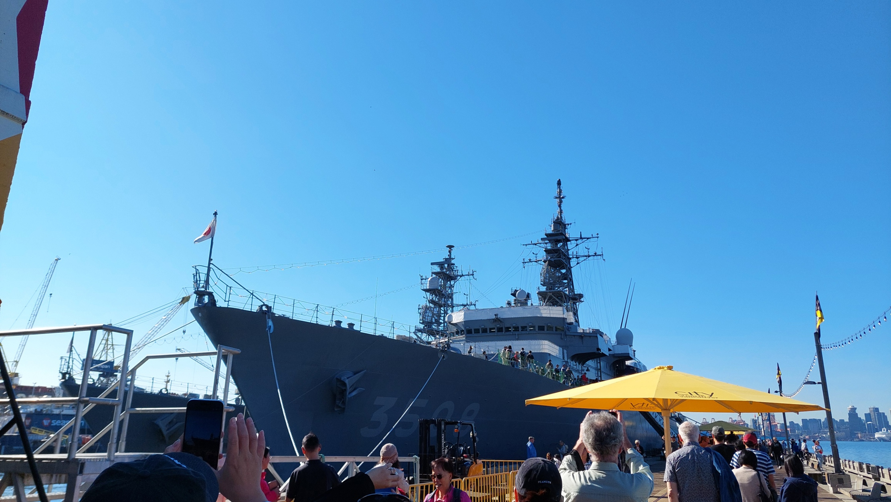
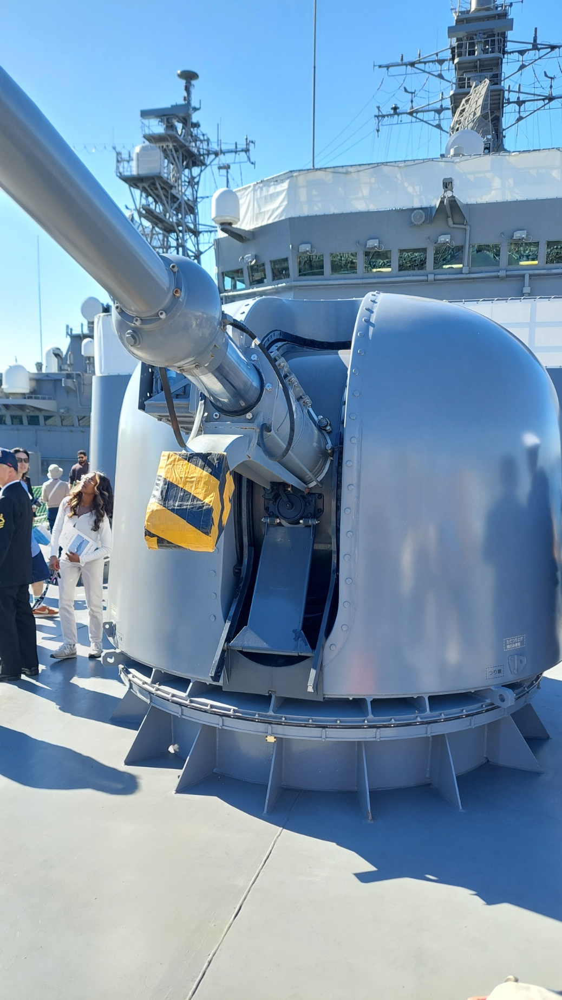
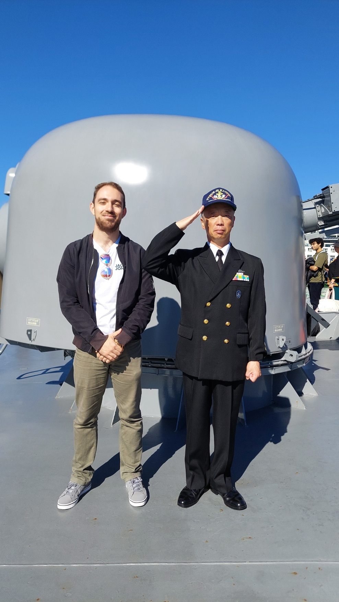
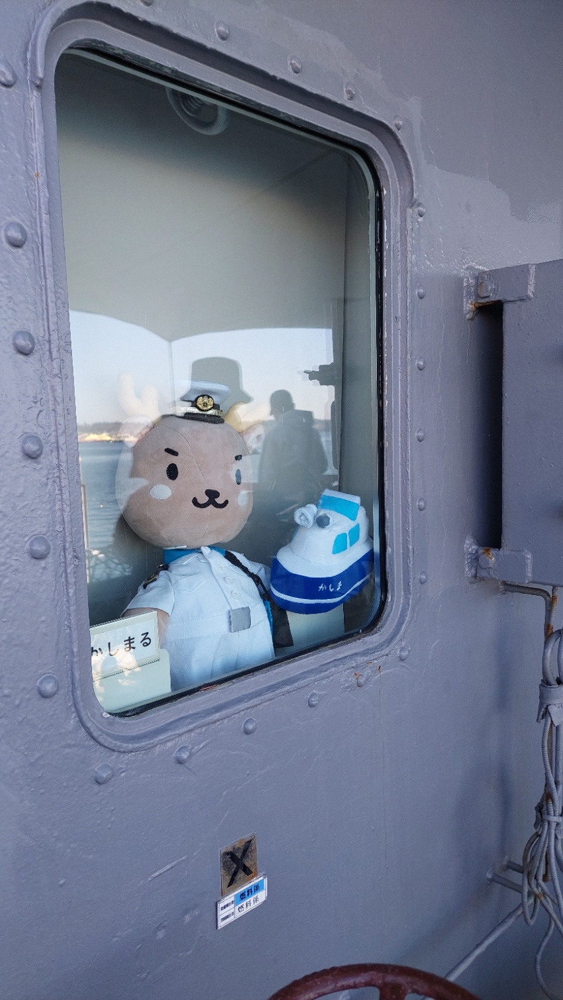
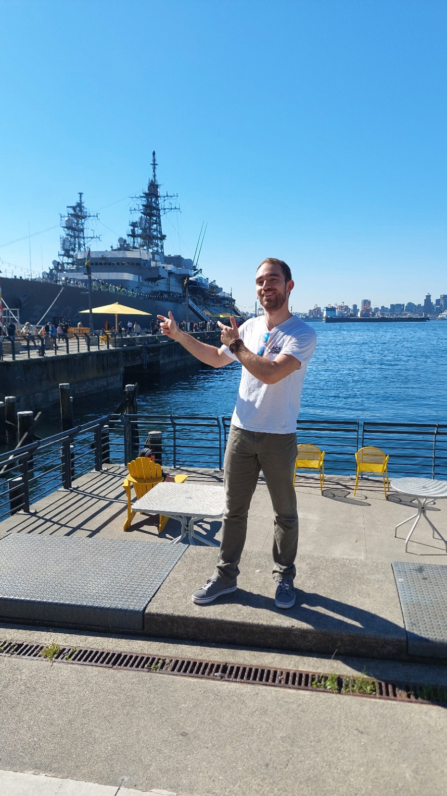

Just a quick visit to a Japanese naval ship before a lecture. That was the plan, at least, after my roommate told me about the opportunity the evening before. There would not be enough time after university, so I had to go beforehand. Surely I could make that work somehow.

JS Kashima was visiting Vancouver with its accompanying ship Yamagiri as part of an overseas training voyage. On September 16, Kashima opened to the public. The visit was also about meeting people and building connections between Japan and Canada, as the [Japanese Consulate-General explains](https://www.vancouver.ca.emb-japan.go.jp/itpr_en/js_kashima_2026_en.html). And I wanted to have a closer look.

## One hour and a rather long queue

Of course, time ended up being a little tighter than expected. I took public transport to Lonsdale Quay in North Vancouver. By the time I reached the ship, I had about an hour before I needed to head back to university. In front of me, though, was a queue considerably longer than I had hoped.

_My time window was fairly small. The queue, unfortunately, was not. My own photo._

Then I spotted the notices about the security checks. An identity document was required, and there were restrictions on backpacks. I had my German ID card and driver's licence with me, but no passport. What I did have was a rather large backpack with my laptop and everything else you take along for a day at university. An excellent combination for spending your time in the queue wondering whether you would actually be allowed aboard.

I stayed in line anyway. Luckily, it moved much faster than it had first appeared. When I finally stood in front of the Japanese crew, I was still half expecting a polite no. Instead, everything was very relaxed. An ID check, a look inside my backpack, and I was actually allowed aboard.

## A university backpack on board

Suddenly, I was standing on the other side of the world, in Vancouver, on a Japanese ship. It did feel a little surreal. Thinking about it now, it might even have been the first time I had ever stood on a ship at all. And straight onto a naval ship, too.

I looked around the ship's structures, trying to understand what the different pieces of equipment were for. Up at the bow was a gun turret, something I had probably only seen in pictures before. Seeing it this close was quite a different experience.

_Not quite the view I usually get before a lecture. My own photo._

The Yamagiri was moored next to us. There was plenty to discover on the information boards too. One explained a device used to move lines and cargo between ships during replenishment at sea. Without the explanation, I probably would not have worked much of that out just by looking at the grey metal.

## A photo with the crew

I was particularly happy to find that you could also take photos with a crew member. So I joined him up at the bow. He saluted for the picture, and I was pretty pleased to have that memory to take home.

_A photo I was particularly happy to take home. My own photo._

Towards the end of the tour, one very special member of the crew was still waiting for us. Behind a window sat a plush toy in uniform with a white cap, alongside a little stuffed ship. After all that grey equipment, it made for a rather charming goodbye.

_Probably the fluffiest member of the crew. My own photo._

## One last photo, then off to class

Back on land, I wanted one more photo of myself with the ship in the background. A man with a camera happened to be walking along the waterfront. If anyone might have a good eye for that, surely it would be him. I did not hesitate for long before asking whether he would take a picture of me.

Luckily, there was still time for that too. Afterwards, I headed back and actually made it to university on time. Between a backpack check and a lecture, I had managed to fit in a little tour of a Japanese ship. Not bad for a plan that had only come together the evening before.

_One quick photo with the ship. Then it was back to an ordinary day at university. My own photo._
