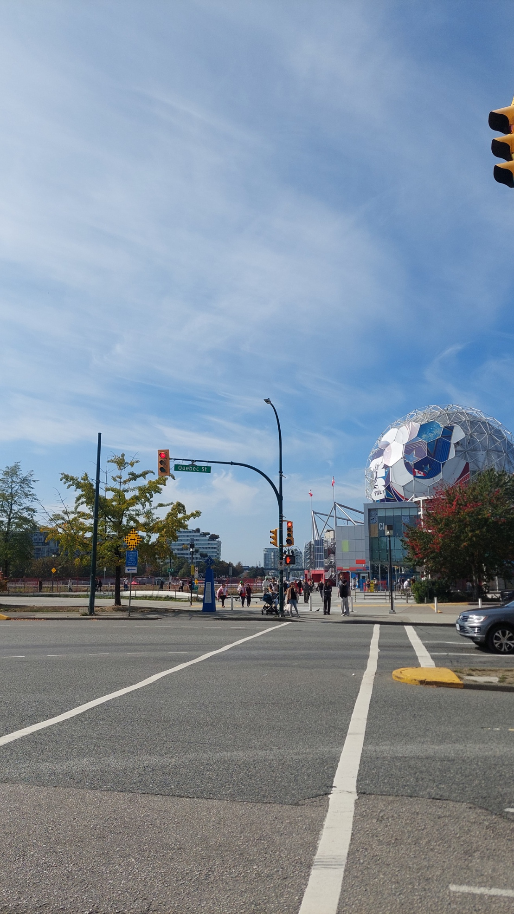
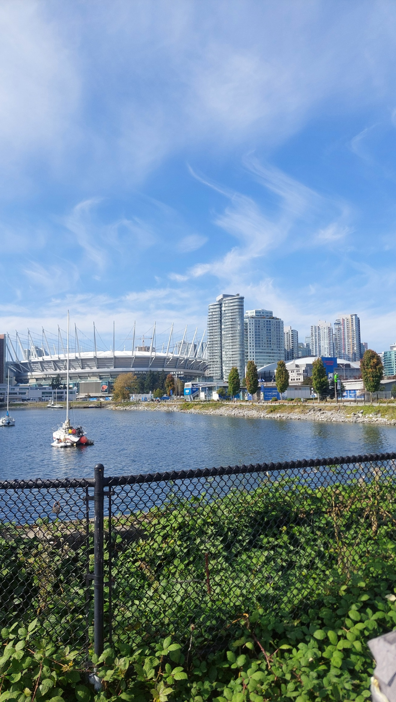
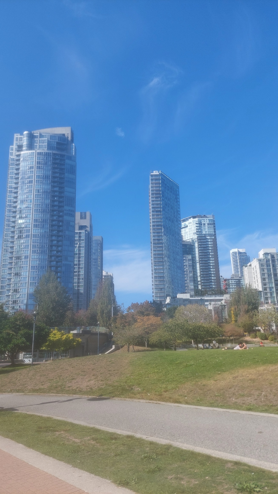
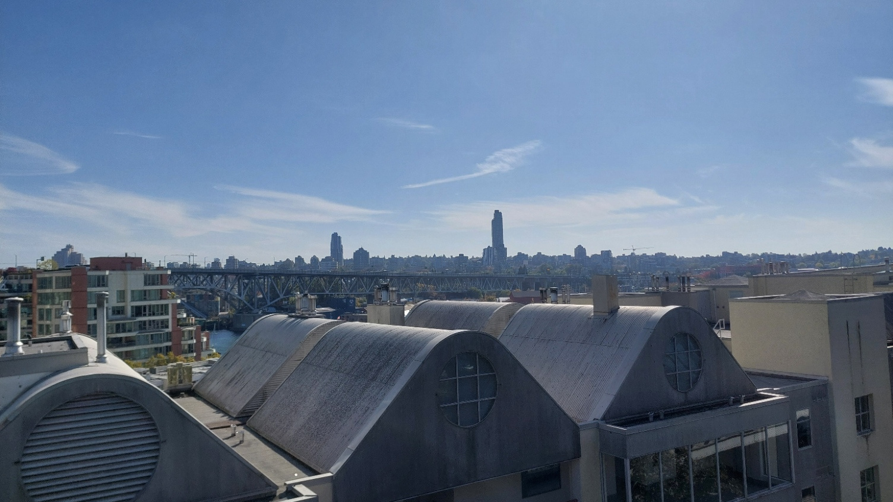
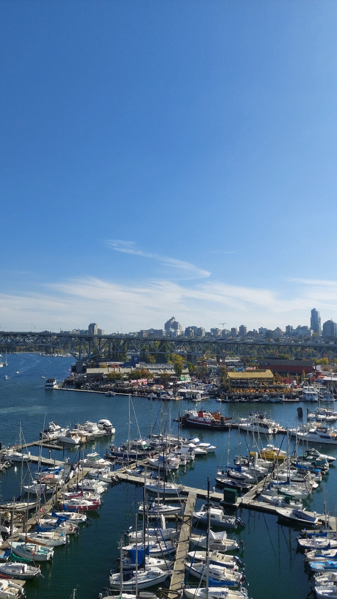
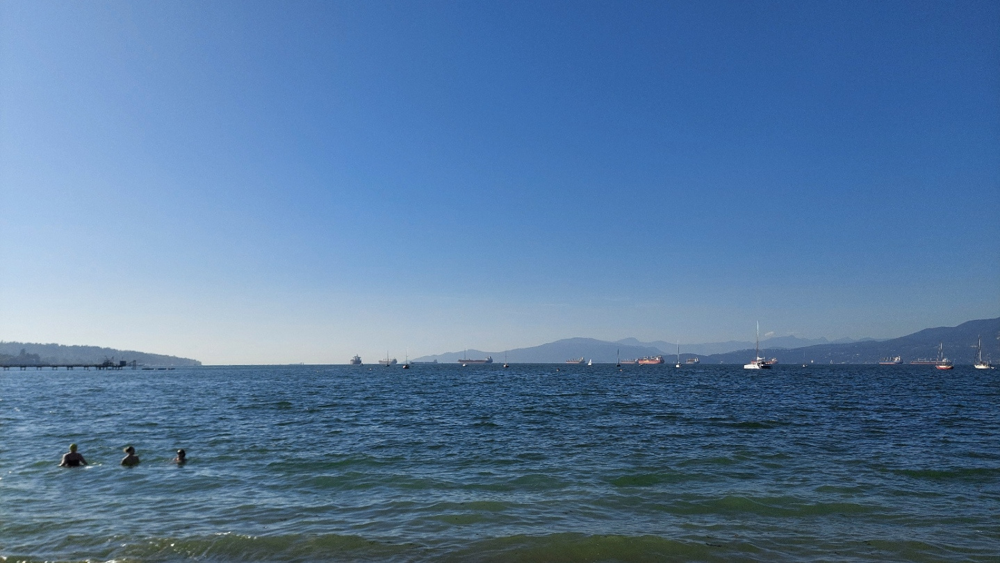
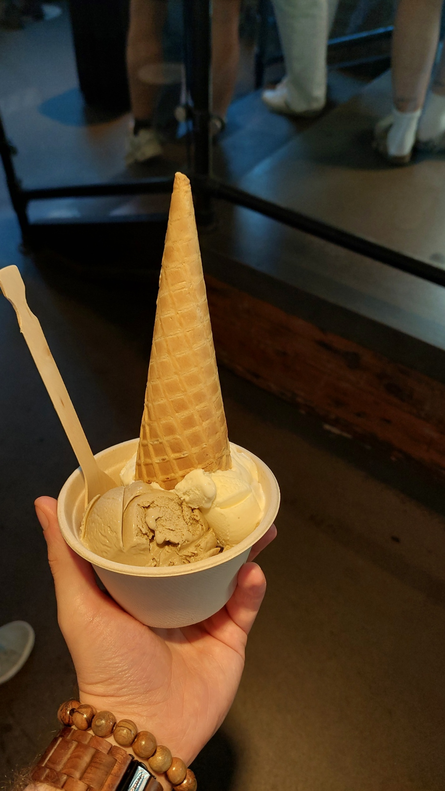
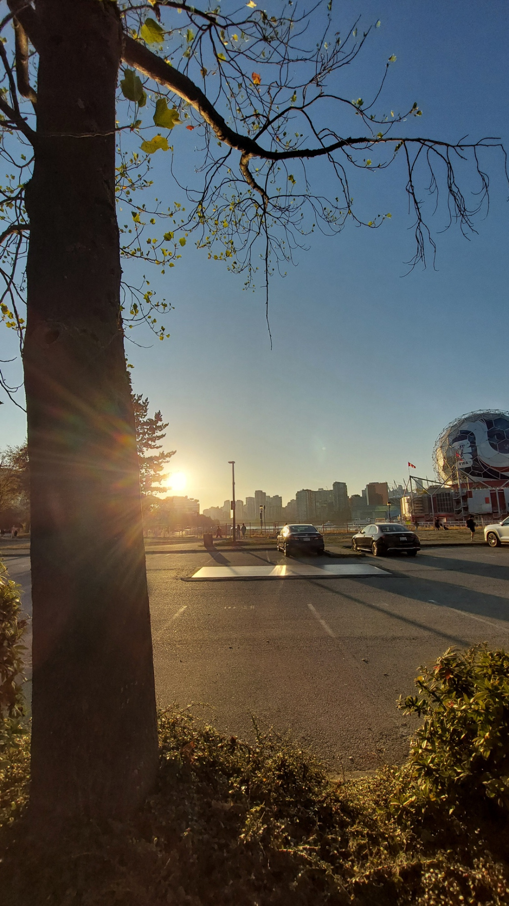

It was an ordinary Saturday, and I did not have much planned yet. So when a roommate asked whether I fancied coming to the beach, I did not have to think about it for long. As it happened, she was German too. Together with another roommate, we wanted to go to Kitsilano Beach, which I had already heard was supposed to be rather lovely.

A good opportunity, then, to get to know Vancouver a little better. That it would turn into not just a beach visit but also quite a long walk was something we worked out along the way.

## Just a little more walking

First, we considered how to get there. Take the bus as close to the beach as possible? Or get off a little earlier and walk for another half hour? By the time we set off around midday, a third option had joined the discussion: get off even earlier and walk for about an hour.

For a relaxing trip to the beach, that sounded like a fairly energetic addition at first. On the other hand, I did want to explore the city. And if you are already in Vancouver, you might as well have a look at Vancouver. So we chose the longer route.

_There was already plenty to discover on the way to the beach. Here, the dome of Science World. My own photo._

## Vancouver along the waterfront

Our walk took us along False Creek. Despite its name, it is not a river but a sea inlet in the middle of the city. High-rise buildings stood on the other side, with sailboats resting on the water in front of them. Every so often, another building appeared that made me stop and wonder what exactly I was looking at.

In this photo, you can see BC Place Stadium with its distinctive roof supports on the left and Rogers Arena just to the right. Two rather large neighbours that fitted nicely into the same photo from this angle.

_BC Place and Rogers Arena across the water. My own photo._

The view changed a little with every stretch of the walk. Sometimes it was the water, sometimes a green space between the buildings, sometimes simply the city against the blue sky. One of the photos looks a little soft and slightly blurred. I thought that was quite cool, actually, so it still belongs here.

_A little blurry, but that is exactly how I like this photo. My own photo._

Later, we crossed the bridge to the other side. From up there, the curved rooftops suddenly lay right in front of us, with another bridge and the city's tall towers beyond them. Another one of those moments when I was glad we had decided to walk.

_Rooftops in front, the city behind. A new view of Vancouver. My own photo._

We also had a good view of all the docks and boats from there. Between the high-rises, the water and the little marinas, there were certainly enough reasons to stop for another photo along the way.

_One more look at the docks before continuing towards the beach. My own photo._

## Finally at Kitsilano Beach

The planned hour had turned into about an hour and twenty minutes by the time we actually arrived at Kitsilano Beach. Naturally, we wanted to go into the water too. It was considerably colder than we had expected, though. We braved it anyway and stayed in for a while before settling back down on the beach.

_The water was cold. We went in anyway. My own photo._

Afterwards, it was time to relax. Sit by the water, talk and let our eyes wander across the bay. I found it quite impressive to be so far from home, on Canada's Pacific coast. The view here is across English Bay rather than directly out onto the open ocean, but it still felt special.

Further west lies Vancouver Island. Perhaps one day I would visit the island too and look straight out over the open Pacific from its west coast. A rather lovely thought to have on an afternoon at the beach.

## 20,000 steps and an ice cream to remember

To round things off, we stopped at Earnest Ice Cream. Over the course of the day, we had clocked up around 20,000 steps. An ice cream break seemed quite appropriate. I tried London Fog and Whiskey Hazelnut, an interesting combination of black tea with bergamot and vanilla on one side, and whiskey with hazelnuts on the other.

And wow, was it good. Not quite first place, but a pretty definite second on my personal list of the best ice creams I have ever eaten. For a spontaneously planned beach trip, that was a rather convincing finish.

_London Fog and Whiskey Hazelnut. A very good decision after a long walk. My own photo._

Later, the sun was already sinking lower, and I captured the evening light one more time. Good company, good conversations, cool water and an ice cream that had earned itself a place among my favourites. An ordinary Saturday had turned into a pretty lovely day in Vancouver.

_One last look at the evening light. A pretty lovely way to end a Saturday. My own photo._
