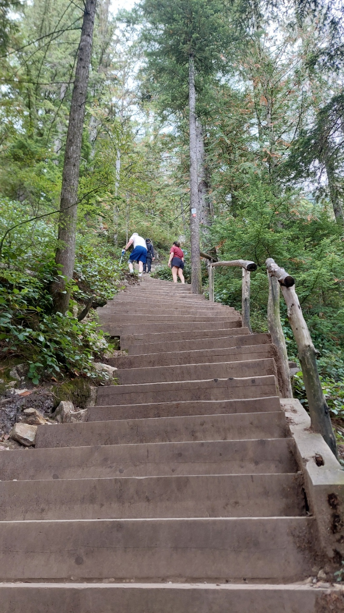
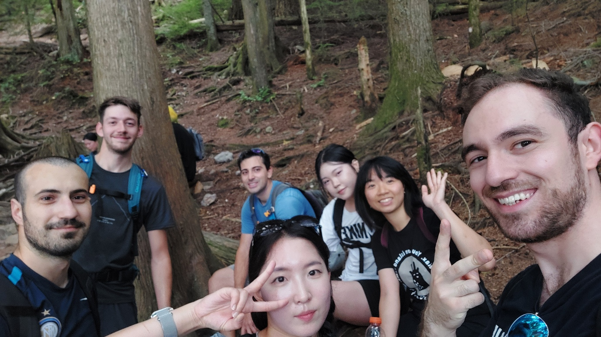
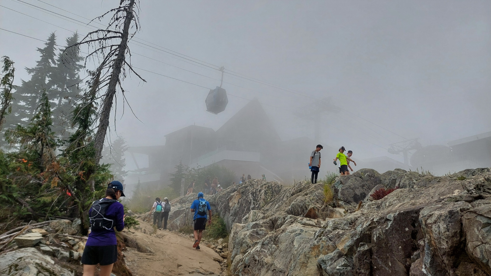
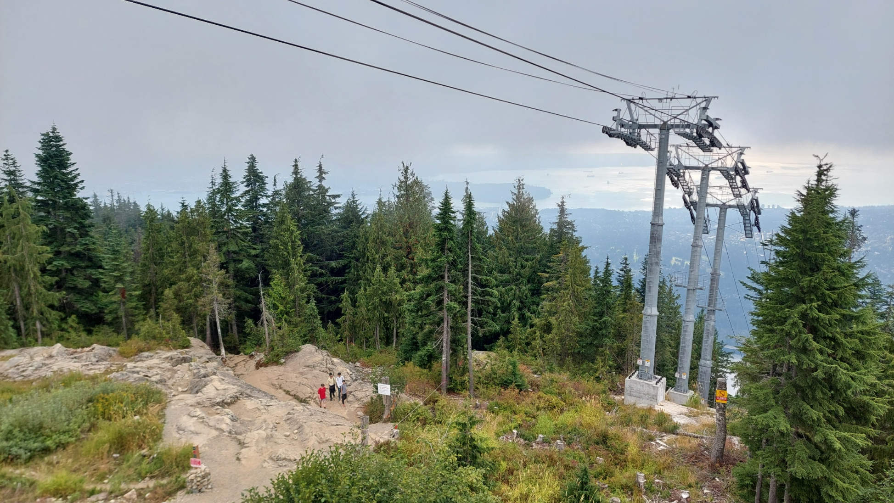
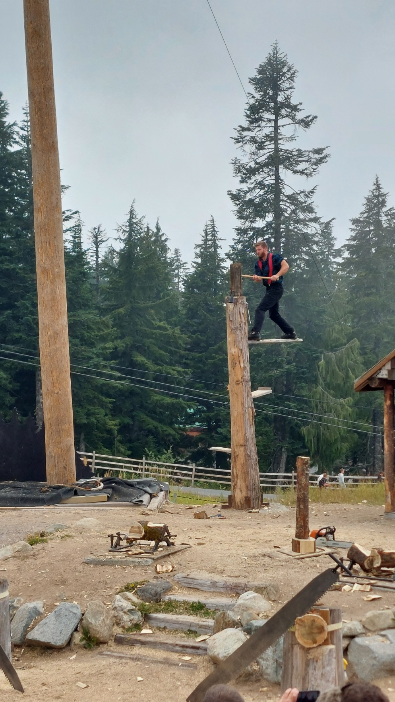
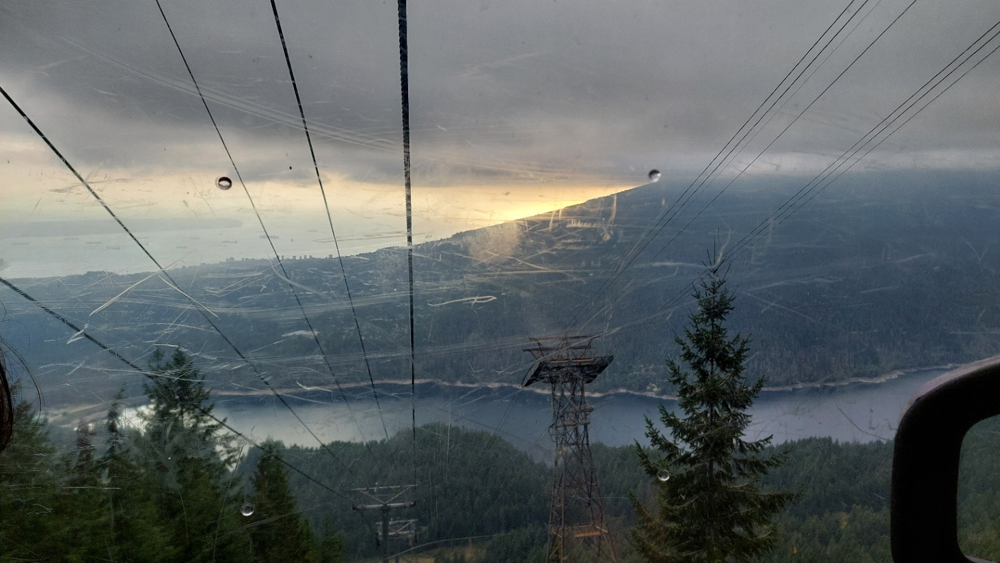
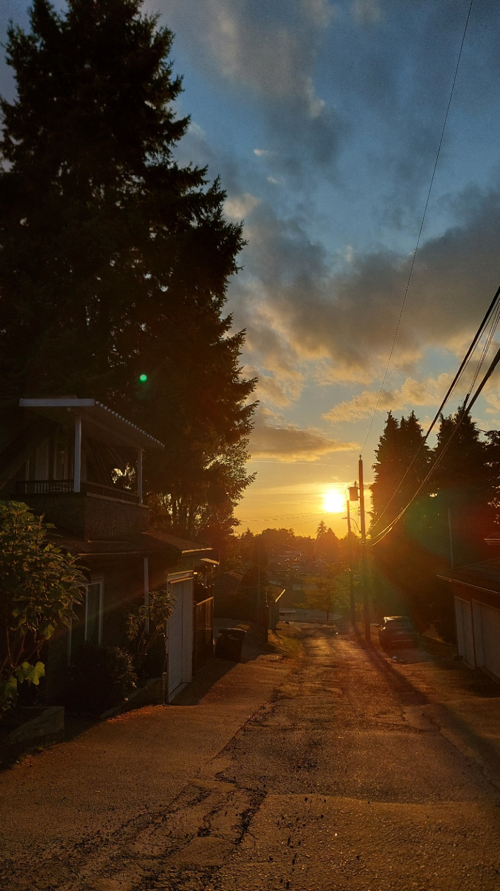

Manche Pläne brauchen monatelange Vorbereitung. Andere entstehen einfach am Abend davor. Meine Mitbewohner wollten den Grouse Grind wandern und fragten, ob ich mitkommen möchte. Rund 800 Höhenmeter, hieß es. Das klang unfassbar anstrengend, nach einer ordentlichen Herausforderung und nach etwas, bei dem ich sehr gerne dabei wäre.

Zum Glück hatte ich meine Wanderstiefel eingepackt. Die hatten schon auf der Reise nach Kanada ihren großen Auftritt gehabt. Jetzt durften sie endlich das tun, wofür sie eigentlich gedacht waren.

## Bekannte Gesichter, ein neuer Berg

Am nächsten Tag machten wir uns gegen Mittag mit dem Auto auf den Weg Richtung North Vancouver. Dort trafen wir den Rest unserer kleinen Wandergruppe. Ganz fremd waren mir die Gesichter nicht mehr. Ein paar Tage zuvor hatten wir gemeinsam einen Potluck gemacht. Dabei bringt jeder etwas zu essen mit, und aus den verschiedenen Gerichten wird ein gemeinsames Buffet. Eine ziemlich schöne Art, Menschen kennenzulernen.

Diesmal stand allerdings kein gedeckter Tisch vor uns, sondern ein Berg. Genauer gesagt der Grouse Mountain. Der [Grouse Grind](https://www.grousemountain.com/grousegrind.html) ist der steile Wanderweg hinauf. Auf etwa 2,5 Kilometern überwindet man rund 800 Höhenmeter und ungefähr 2.830 Stufen. Viel Wald, viele Treppen und eine ziemlich eindeutige Richtung: nach oben.

Meine letzte Wanderung war ungefähr ein Jahr her. Eine hervorragende Gelegenheit also, direkt wieder etwas größer einzusteigen.

## Stufe für Stufe

Mit einer Wasserflasche, meinen Wanderstiefeln und Wanderklamotten ging es los. Ich hatte Respekt vor dem Aufstieg, aber genauso viel Lust darauf. Und die blieb mir auch unterwegs erhalten, selbst als sich die angekündigten Höhenmeter langsam in den Beinen bemerkbar machten.

Am Anfang unterhielten wir uns noch ganz entspannt über dies und das, während wir zwischen den hohen Bäumen immer weiter nach oben liefen. Nach ungefähr einem Viertel des Weges wurden die Gespräche etwas kürzer, und wir waren zunehmend mit dem Verschnaufen beschäftigt. Einatmen, ausatmen, nächste Stufe.

_Falls noch unklar war, in welche Richtung es weitergeht. Eigenes Foto._

Wir machten Pausen, verschnauften und gingen dann das nächste Stück an. Nicht besonders schnell, aber Stück für Stück. Zwischen Wurzeln, Felsen und den ganzen Stufen gab es einen ziemlich schönen Wald zu sehen. Und genug Zeit für ein gemeinsames Foto war natürlich auch noch.

_Gute Gesellschaft macht die Stufen zwar nicht weniger, aber den Weg deutlich schöner. Eigenes Foto._

## Oben zwischen den Wolken

Irgendwann hatten wir es tatsächlich geschafft und standen oben, außer Atem und ziemlich zufrieden. Jetzt also erstmal die Aussicht genießen. Nur waren vor uns vor allem Wolken. Da hatte ich mich einen Berg hinaufgearbeitet, um oben festzustellen, dass der Blick in die Ferne erstmal ausfallen würde.

_Oben angekommen. Die Aussicht hielt sich erstmal noch bedeckt. Eigenes Foto._

Gelohnt hatte es sich trotzdem. Im Chalet, der Berghütte mit Gastronomie, machten wir es uns erstmal gemütlich. Wir aßen etwas, tranken ein Bierchen und konnten wieder miteinander reden, ohne zwischendurch nach Luft suchen zu müssen.

Ganz ohne Aussicht blieb der Tag dann zum Glück doch nicht. Die Wolken lichteten sich ein wenig, und zwischen den Bäumen konnte man plötzlich wieder weiter schauen. Für dieses Bild hatte es immerhin gereicht:

_Die Wolken machten doch noch ein bisschen Platz. Eigenes Foto._

## Bibergebäck und Holzfällerhumor

Anschließend schlenderten wir noch über das Gelände oben am Berg, schauten uns ein paar Holzfiguren an und kamen an einem Stand mit BeaverTails vorbei.

Schon wieder etwas Kanadisches, das ich noch probieren musste. Das sind flache, länglich geformte Teigfladen, die frittiert und mit verschiedenen süßen Belägen serviert werden. Die Form erinnert an einen Biberschwanz, daher der Name. Zum Glück also Gebäck und kein Biber. Die Schlange war allerdings ziemlich lang. Na gut, dann sollte es wohl an einem anderen Tag sein.

Dafür schauten wir uns noch die Lumberjack-Show an. Holzfäller, Äxte und Menschen, die auf Baumstämmen Dinge machten, bei denen ich lieber vom Boden aus zusah.

_Andere waren mit dem Klettern für heute offenbar noch nicht fertig. Eigenes Foto._

Ich glaube, so dämlichen Humor hatte ich lange nicht mehr gesehen. Mir hat's gefallen.

## Mit der Gondel ins Abendlicht

Nach einem kurzen Abstecher in den Souvenirshop ging es mit der Gondel wieder bergab. Meine Beine hatten gegen diese Entscheidung überraschend wenig einzuwenden.

Als wir durch die Wolkendecke nach unten kamen, lag unter den grauen Wolken plötzlich das warme Licht der sinkenden Sonne. Oben hatten wir schon einen Blick auf die Küste erhascht, aber von der Gondel aus sah alles noch einmal anders aus. Die Berge, das Wasser und dieser goldene Streifen am Horizont machten die Talfahrt zu einem ziemlich schönen Teil des Tages.

_Berge, Wasser und ein goldener Streifen unter den Wolken. Eigenes Foto._

Rund 800 Höhenmeter, ungefähr 2.830 Stufen und eine Gondelfahrt später gönnte ich mir mit meiner Mitbewohnerin noch einen Bubble Tea. Die Sonne hatte inzwischen noch etwas nachgelegt. Auf dem Weg hielt ich das Abendlicht noch einmal fest.

Meine erste Wanderung in Kanada war geschafft. Mit müden Beinen, guter Gesellschaft und der ziemlich eindeutigen Erkenntnis, dass die Wanderstiefel ihren Platz im Koffer verdient hatten.

_So durfte meine erste Wanderung in Kanada gerne enden. Eigenes Foto._
