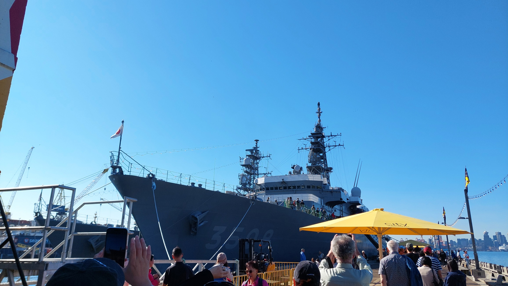
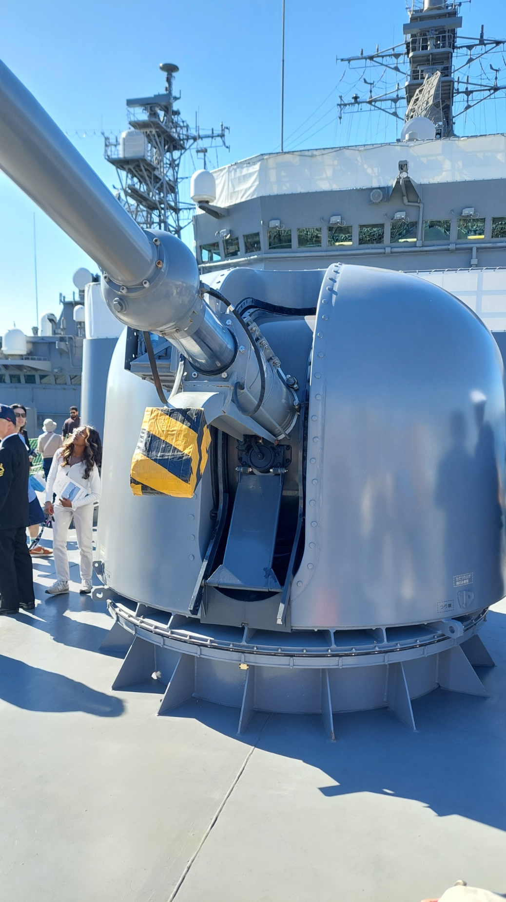
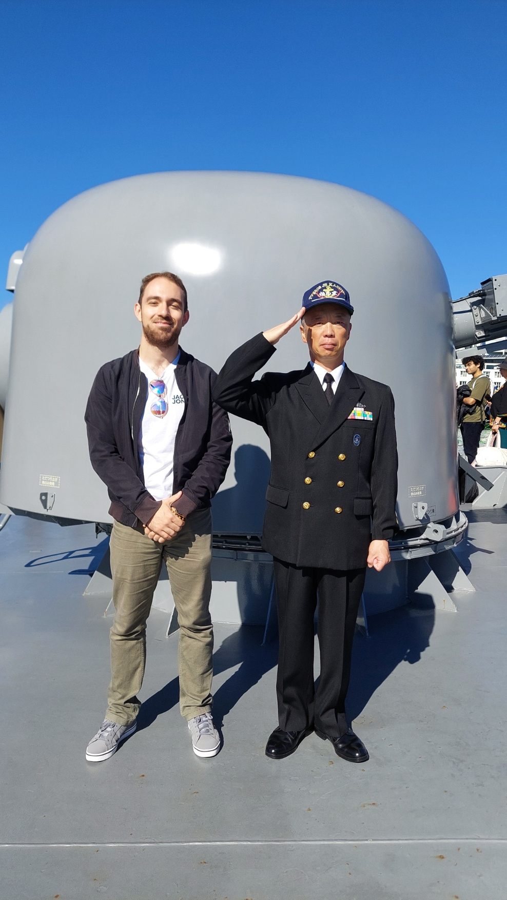
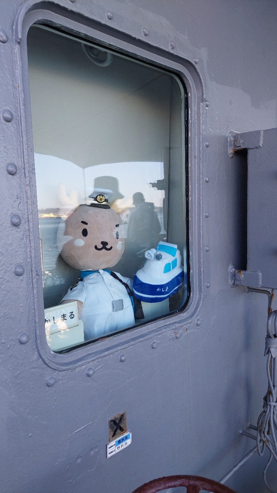
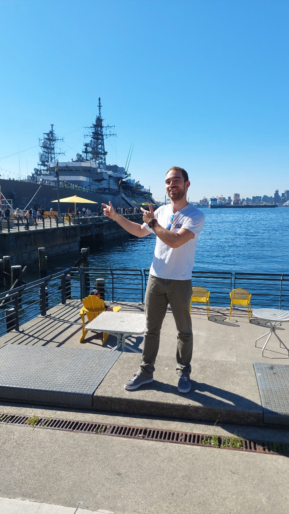

Vor einer Vorlesung noch schnell ein japanisches Marineschiff besichtigen. Das war zumindest der Plan, nachdem mir mein Mitbewohner am Abend davor von der Gelegenheit erzählt hatte. Nach der Uni würde es zeitlich nicht mehr passen. Also musste ich vorher hin. Sollte sich doch irgendwie einrichten lassen.

Die JS Kashima war zusammen mit ihrem Begleitschiff Yamagiri im Rahmen einer Ausbildungsreise in Vancouver zu Besuch. Am 16. September wurde die Kashima für die Öffentlichkeit geöffnet. Es ging dabei auch um Begegnungen und den Austausch zwischen Japan und Kanada, wie das [japanische Generalkonsulat berichtet](https://www.vancouver.ca.emb-japan.go.jp/itpr_en/js_kashima_2026_en.html). Und ich wollte mir das gerne aus der Nähe anschauen.

## Eine Stunde und eine ziemlich lange Schlange

Natürlich wurde es dann doch etwas enger als gedacht. Mit dem ÖPNV fuhr ich zum Lonsdale Quay nach North Vancouver. Als ich am Schiff ankam, hatte ich noch ungefähr eine Stunde, bevor ich mich wieder auf den Weg zur Uni machen musste. Vor mir stand allerdings eine Schlange, die wesentlich länger war, als ich gehofft hatte.

_Mein Zeitfenster war überschaubar. Die Schlange leider weniger. Eigenes Foto._

Dann entdeckte ich noch die Hinweise zur Kontrolle. Ein Ausweisdokument wurde benötigt, und bei Rucksäcken gab es Einschränkungen. Ich hatte meinen deutschen Perso und Führerschein dabei, aber keinen Reisepass. Dafür einen ziemlich großen Rucksack mit Laptop und allem, was man eben für einen Unitag so mitnimmt. Eine hervorragende Kombination, um sich beim Warten zu fragen, ob man am Ende überhaupt an Bord darf.

Ich blieb trotzdem in der Schlange. Zum Glück ging es deutlich zügiger voran, als es zunächst ausgesehen hatte. Als ich schließlich vor der japanischen Besatzung stand, rechnete ich noch halb mit einem freundlichen Nein. Stattdessen verlief alles ganz entspannt. Ausweis kontrolliert, ein Blick in den Rucksack, und ich durfte tatsächlich hinauf.

## Mit Unirucksack an Bord

Plötzlich stand ich auf der anderen Seite der Welt, in Vancouver, auf einem japanischen Schiff. Ein bisschen surreal war das schon. Wenn ich so darüber nachdenke, war es vielleicht sogar das erste Mal, dass ich überhaupt auf einem Schiff stand. Und dann direkt auf einem Marineschiff.

Ich schaute mich zwischen den Aufbauten um und versuchte zu verstehen, wofür die verschiedenen Anlagen gedacht waren. Vorne am Bug stand ein Geschützturm, den ich sonst höchstens von Bildern gekannt hätte. Den jetzt aus der Nähe zu sehen, war noch einmal etwas ganz anderes.

_Nicht ganz die Aussicht, die ich sonst vor einer Vorlesung habe. Eigenes Foto._

Nebenan lag noch die Yamagiri. Auch die Infotafeln lieferten einiges zu entdecken. Eine erklärte zum Beispiel eine Vorrichtung, mit der bei der Versorgung auf See Leinen und Ladung zwischen Schiffen bewegt werden. Ohne die Erklärung hätte ich aus dem grauen Metall allein vermutlich wenig herauslesen können.

## Ein Foto mit der Besatzung

Besonders freute ich mich darüber, dass man auch Fotos mit einem Mitglied der Besatzung machen konnte. Also stellte ich mich vorne am Bug dazu. Er salutierte für das Bild, und ich war ziemlich glücklich, diese Erinnerung mitnehmen zu können.

_Ein Foto, über das ich mich besonders gefreut habe. Eigenes Foto._

Gegen Ende der Runde wartete dann noch ein ganz besonderes Mitglied der Besatzung auf uns. Hinter einem Fenster saß ein Plüschtier in Uniform mit weißer Mütze, daneben ein kleines Stoffschiff. Nach all der grauen Technik war das ein ziemlich sympathischer Abschied.

_Der vermutlich flauschigste Teil der Besatzung. Eigenes Foto._

## Noch ein Bild, dann zur Uni

Wieder an Land wollte ich noch ein Foto von mir mit dem Schiff im Hintergrund haben. Auf der Promenade kam gerade ein Mann mit einer Kamera vorbei. Wenn jemand dafür ein gutes Auge haben könnte, dann doch hoffentlich er. Ich zögerte nicht lange und fragte ihn, ob er ein Bild von mir machen würde.

Zum Glück klappte auch das noch. Danach machte ich mich auf den Rückweg und kam tatsächlich pünktlich zur Uni. Zwischen Rucksackkontrolle und Vorlesung hatte also noch eine kleine Rundtour auf einem japanischen Schiff Platz gefunden. Nicht schlecht für einen Plan, der erst am Abend davor entstanden war.

_Noch schnell ein Foto mit dem Schiff. Danach wartete wieder der ganz normale Unitag. Eigenes Foto._
