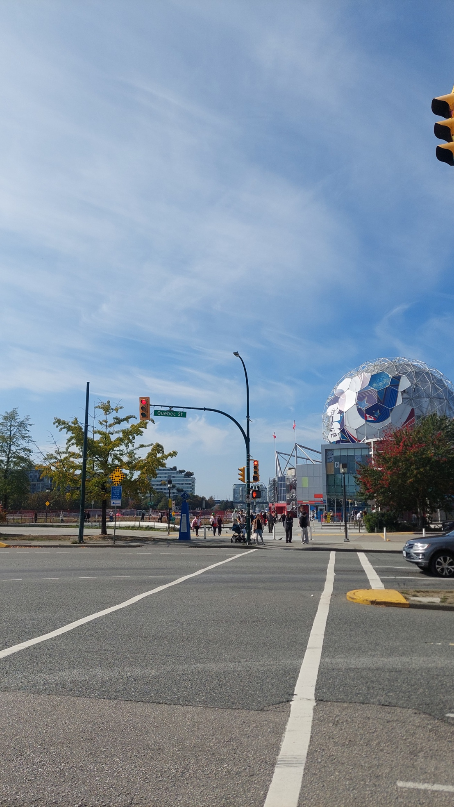
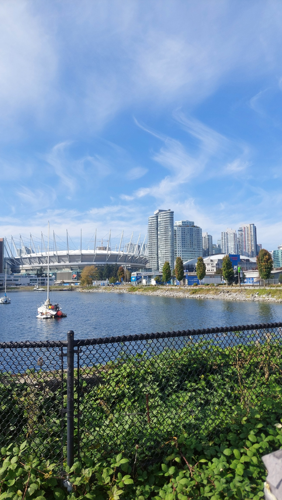
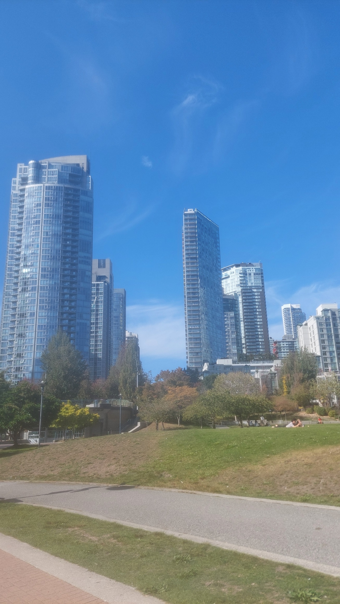
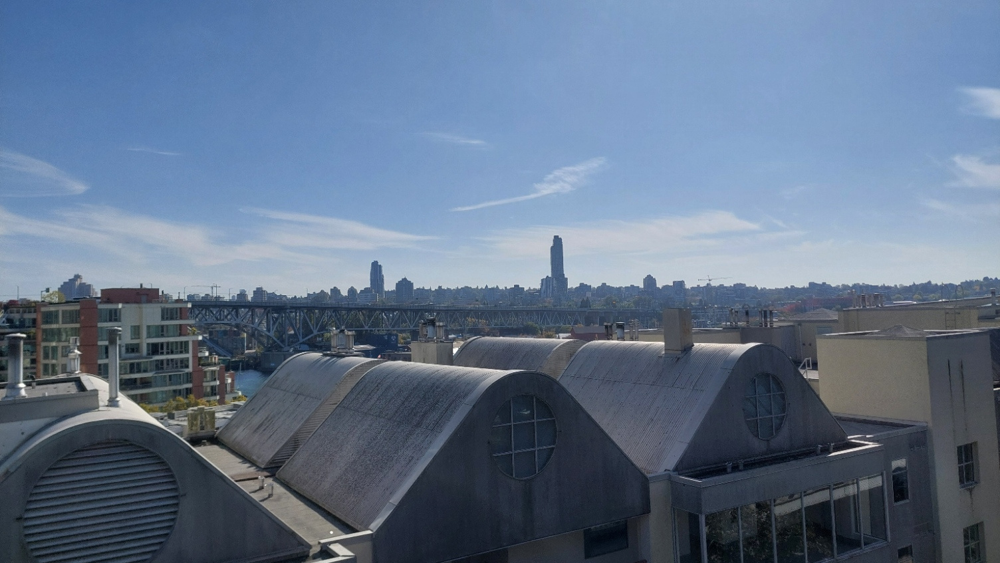
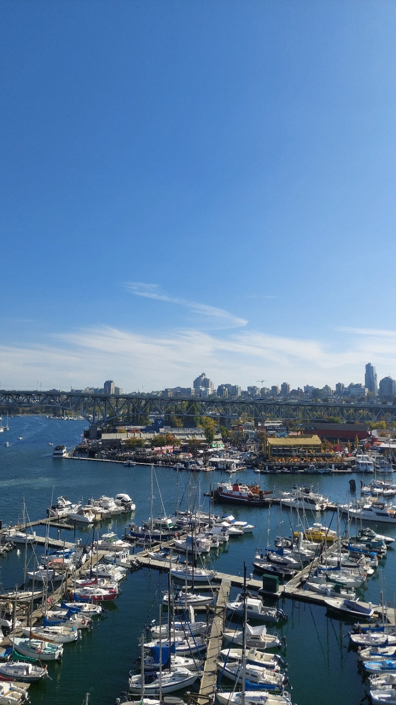
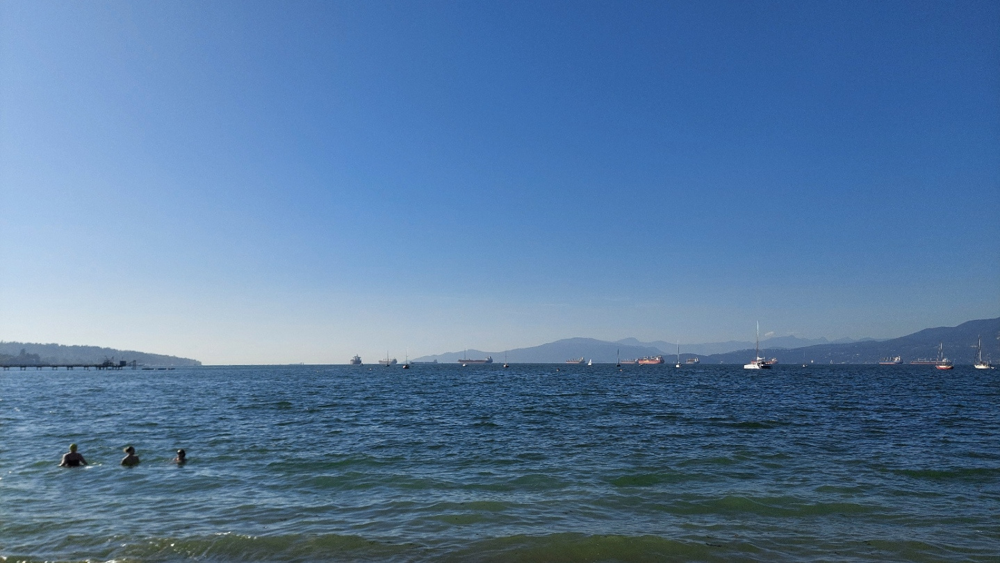
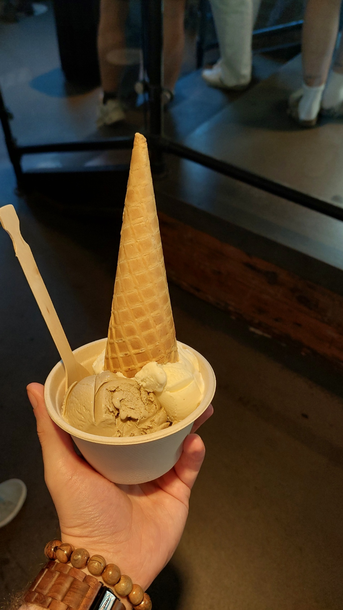
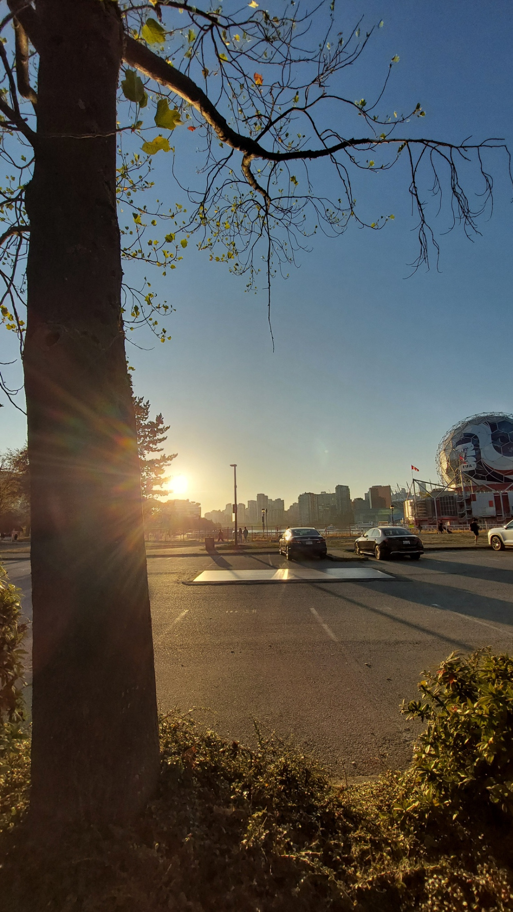

Es war ein ganz normaler Samstag, und besonders viel hatte ich noch nicht vor. Als mich eine Mitbewohnerin fragte, ob ich Lust hätte, mit an den Strand zu kommen, musste ich deshalb nicht lange überlegen. Sie war witzigerweise ebenfalls Deutsche. Zusammen mit einer weiteren Mitbewohnerin wollten wir zum Kitsilano Beach, von dem ich schon gehört hatte, dass er ziemlich schön sein sollte.

Eine gute Gelegenheit also, Vancouver ein bisschen besser kennenzulernen. Dass daraus nicht nur ein Strandbesuch, sondern auch ein längerer Spaziergang werden würde, ergab sich dann eher unterwegs.

## Nur noch ein bisschen laufen

Zuerst überlegten wir, wie wir hinkommen wollten. Mit dem Bus möglichst nah an den Strand fahren? Oder etwas früher aussteigen und noch eine halbe Stunde laufen? Als wir uns gegen Mittag auf den Weg machten, kam dann noch eine dritte Möglichkeit dazu: noch früher aussteigen und ungefähr eine Stunde zu Fuß gehen.

Das klang für einen entspannten Strandausflug erstmal nach einer recht sportlichen Ergänzung. Andererseits wollte ich die Stadt ja erkunden. Und wenn man schon in Vancouver ist, kann man sich Vancouver schließlich auch anschauen. Also entschieden wir uns für den längeren Weg.

_Unterwegs zum Strand gab es schon genug zu entdecken. Hier die Kugel von Science World. Eigenes Foto._

## Vancouver am Wasser entlang

Unser Spaziergang führte uns am False Creek entlang. Trotz des Namens ist das kein Fluss, sondern eine Meeresbucht mitten in der Stadt. Auf der anderen Seite standen die Hochhäuser, davor lagen Segelboote im Wasser. Dazwischen tauchten immer wieder Gebäude auf, bei denen ich erstmal überlegen musste, was ich da eigentlich vor mir hatte.

Auf diesem Bild sieht man links das BC Place Stadium mit seinen auffälligen Dachstützen und rechts daneben die Rogers Arena. Zwei ziemlich große Nachbarn, die sich aus dieser Perspektive gut zusammen fotografieren ließen.

_BC Place und Rogers Arena auf der anderen Seite des Wassers. Eigenes Foto._

Mit jedem Stück des Weges änderte sich der Blick ein wenig. Mal war es das Wasser, mal eine Grünfläche zwischen den Häusern und mal einfach die Stadt vor dem blauen Himmel. Eines der Fotos wirkt dabei etwas weich und leicht verschwommen. Gerade das fand ich irgendwie cool, deshalb gehört es für mich trotzdem hierher.

_Ein bisschen unscharf, aber genau so mag ich das Bild. Eigenes Foto._

Später ging es über die Brücke auf die andere Seite. Von oben lagen plötzlich die geschwungenen Dächer direkt vor uns, dahinter eine weitere Brücke und die Stadt mit ihren hohen Türmen. Wieder einer dieser Momente, in denen ich froh war, dass wir uns für den Fußweg entschieden hatten.

_Dächer im Vordergrund, Stadt dahinter. Ein neuer Blick auf Vancouver. Eigenes Foto._

Auch die vielen Stege und Boote ließen sich von dort gut überblicken. Zwischen den Hochhäusern, dem Wasser und den kleinen Häfen gab es jedenfalls genug Gründe, zwischendurch für ein Foto stehen zu bleiben.

_Noch ein Blick auf die Stege, bevor es weiter Richtung Strand ging. Eigenes Foto._

## Endlich am Kitsilano Beach

Aus der geplanten Stunde waren am Ende ungefähr eine Stunde und zwanzig Minuten geworden. Dann waren wir tatsächlich am Kitsilano Beach angekommen und wollten natürlich auch ins Wasser. Das war allerdings wesentlich kühler, als wir erwartet hatten. Wir trauten uns trotzdem hinein und blieben eine Weile darin, bevor wir es uns wieder am Strand gemütlich machten.

_Das Wasser war kalt. Wir waren trotzdem drin. Eigenes Foto._

Danach war erstmal Entspannen angesagt. Am Wasser sitzen, miteinander reden und den Blick über die Bucht schweifen lassen. Ich fand es ziemlich beeindruckend, so weit von zu Hause entfernt an Kanadas Pazifikküste zu sein. Hier schaut man zwar auf die English Bay und nicht direkt auf den offenen Ozean, aber besonders fühlte es sich trotzdem an.

Weiter westlich liegt noch Vancouver Island. Vielleicht würde ich irgendwann auch die Insel besuchen und an ihrer Westküste direkt auf den offenen Pazifik schauen. Das war jedenfalls ein ziemlich schöner Gedanke für einen Nachmittag am Strand.

## Rund 20.000 Schritte und ein Eis auf Platz zwei

Zum Abschluss ging es noch zu Earnest Ice Cream. Im Laufe des Tages kamen rund 20.000 Schritte zusammen. Da passte eine Pause mit Eis ziemlich gut. Ich probierte London Fog und Whiskey Hazelnut, eine interessante Mischung aus Schwarztee mit Bergamotte und Vanille auf der einen Seite und Whiskey mit Haselnüssen auf der anderen.

Und man, war das gut. Nicht ganz Platz eins, aber ziemlich eindeutig Platz zwei auf meiner persönlichen Liste der besten Eiscremes, die ich bisher gegessen habe. Für einen spontan geplanten Strandausflug war das ein ziemlich überzeugender Abschluss.

_London Fog und Whiskey Hazelnut. Eine sehr gute Entscheidung nach einem langen Spaziergang. Eigenes Foto._

Später stand die Sonne schon tiefer, und ich hielt noch einmal das Abendlicht mit der Kamera fest. Gute Gesellschaft, gute Gespräche, kühles Wasser und ein Eis, das sich direkt einen Platz in meiner Bestenliste gesichert hatte. Aus einem ganz normalen Samstag war ein ziemlich schöner Tag in Vancouver geworden.

_Ein letzter Blick ins Abendlicht. So durfte der Samstag gerne enden. Eigenes Foto._
